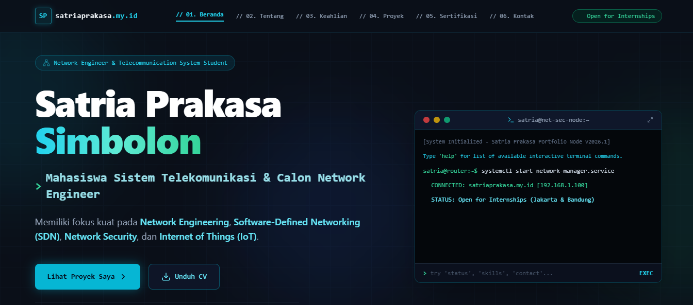
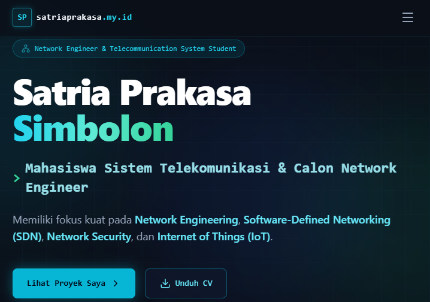
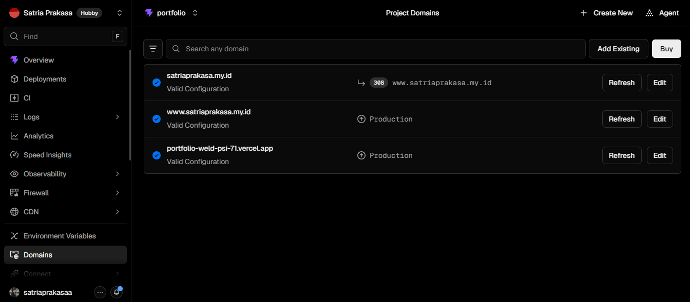
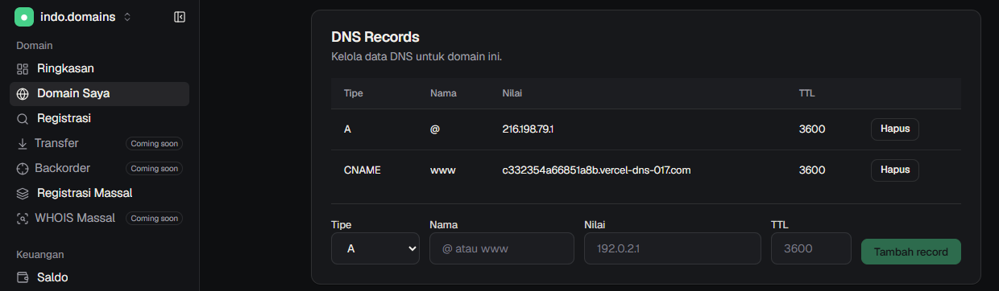
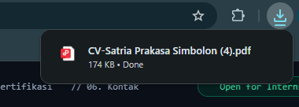

# 🌐 [PERSONAL PROJECT] Personal Portfolio Website & Custom Domain Integration


Dokumen ini berisi dokumentasi dan studi kasus perancangan, pengembangan antarmuka, serta pengintegrasian infrastruktur jaringan/DNS untuk **Website Portofolio Pribadi Satria Prakasa Simbolon** (Mahasiswa Sistem Telekomunikasi - Spesialisasi Network & Security Engineering).

🔗 **Live Website:** [https://satriaprakasa.my.id](https://satriaprakasa.my.id)  
🔗 **Alternative URL:** [https://www.satriaprakasa.my.id](https://www.satriaprakasa.my.id)

---

## 📸 Preview Tampilan & Dokumentasi

| Desktop View | Mobile View |
| :---: | :---: |
|  |  |

---

## 📌 Ringkasan Proyek (Overview)

Proyek ini bertujuan untuk membangun platform portofolio web yang responsif, cepat, dan aman. Selain berfokus pada pengalaman pengguna (UI/UX), proyek ini menjadi bukti praktik langsung dalam **manajemen domain, konfigurasi record DNS Anycast, dan penerbitan sertifikat SSL/TLS di Edge Network**.

### Fitur Utama:
- **Interactive CLI Terminal Emulator:** Widget terminal interaktif bertema Linux/Networking di Hero Section yang merespons perintah teks input kustom.
- **Responsive UI/UX:** Tampilan antarmuka bertema cyber/network yang adaptif di layar desktop, tablet, dan smartphone.
- **Direct PDF Asset Downloader:** Integrasi tombol unduh CV interaktif yang mengakses aset statis PDF di folder `public/`.
- **Custom Domain & Anycast Routing:** Pemetaan domain lokal `.my.id` ke infrastruktur global Vercel.
- **Automated SSL/TLS (HTTPS):** Pengamanan enkripsi koneksi menggunakan sertifikat SSL otomatis dari Vercel CA.
  
---

## 🛠️ Stack Teknologi & Infrastruktur

- **Frontend Framework:** React.js / Next.js
- **Styling:** Tailwind CSS
- **Hosting & Deployment:** Vercel Cloud Platform
- **Domain Registrar:** indo.domains
- **DNS Architecture:** Anycast Routing (A Record & CNAME)
- **Version Control:** Git & GitHub

---

## 📡 Konfigurasi Network & DNS Integration

Sebagai bagian dari studi kasus *Network Engineering*, domain kustom `satriaprakasa.my.id` dikonfigurasikan dengan memetakan DNS Record dari *Registrar Panel* ke *Vercel Edge Network*:

### 1. Tabel DNS Records (`indo.domains`)
| Record Type | Hostname / Name | Value / Destination | Fungsi |
| :---: | :---: | :---: | :--- |
| **A Record** | `@` | `216.198.79.1` | Mengarahkan root domain ke Vercel Anycast IP |
| **CNAME** | `www` | `c332354a66851a8b.vercel-dns-017.com.` | Mengarahkan ke DNS target spesifik Vercel |

### 2. Edge Routing & SSL Verification
- **Permanent Redirection (308):** Mengarahkan trafik dari `satriaprakasa.my.id` ke domain utama `www.satriaprakasa.my.id`.
- **SSL Certificate Provisioning:** Enkripsi HTTPS otomatis diverifikasi oleh Vercel CA.

<p align="center">
  <br>
  <i>Gambar 1: Verifikasi Valid Configuration di Dashboard Vercel</i>
</p>

<p align="center">
  <br>
  <i>Gambar 2: Konfigurasi DNS Record di Panel indo.domains</i>
</p>

---

## 📄 Fitur Unduh CV (Direct Downloader)

Pengujian fitur unduh CV PDF diuji secara otomatis dari folder publik:

<p align="center">
  <br>
  <i>Gambar 3: Pengujian Unduh File PDF CV Berhasil</i>
</p>

---

## 📁 Struktur Direktori Proyek

```text
network-portfolio-web/
├── docs/                        # Folder dokumentasi screenshot
│   ├── 01-homepage-preview.png
│   ├── 02-responsive-view.png
│   ├── 03-vercel-valid-domain.png
│   ├── 04-indo-domains-dns.png
│   └── 05-cv-download-feature.png
├── public/                      # File aset statis
│   └── CV_Satria_Prakasa_Simbolon.pdf
├── src/                         # Source code aplikasi
├── .gitignore
├── LICENSE
├── package.json
└── README.md                    # Dokumentasi utama proyek
